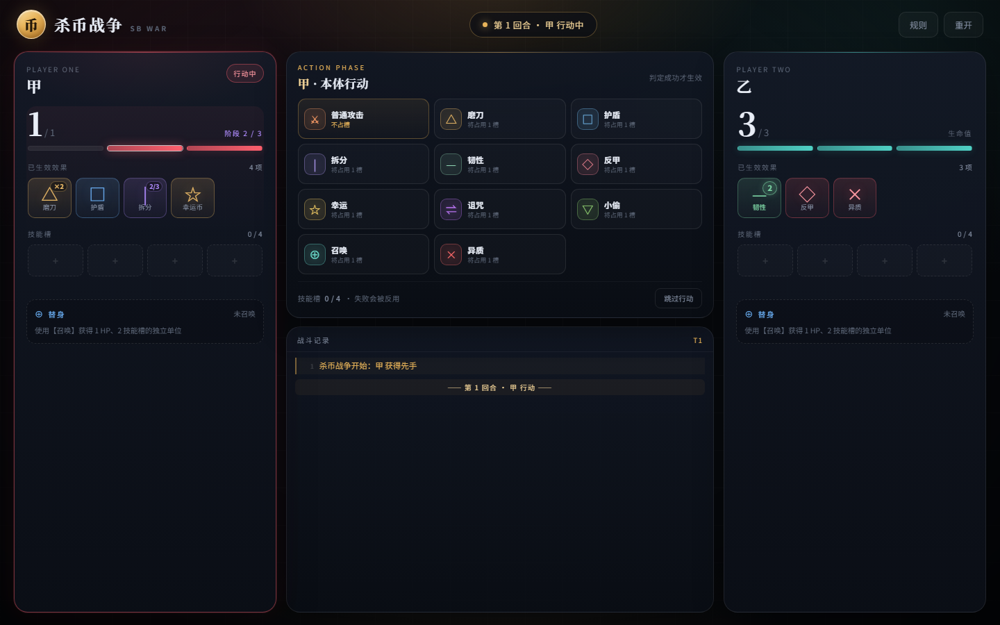
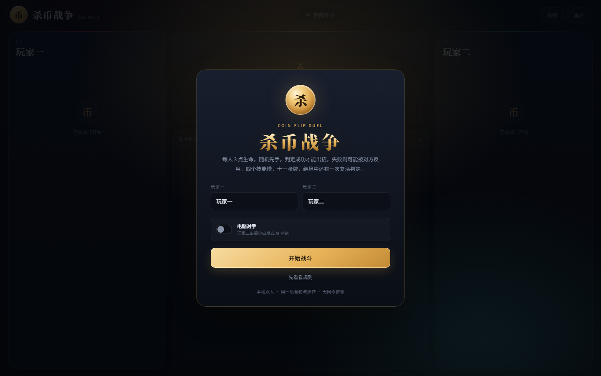
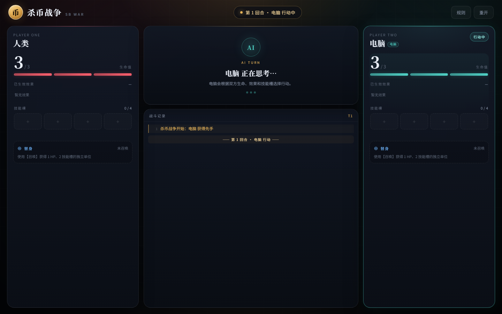
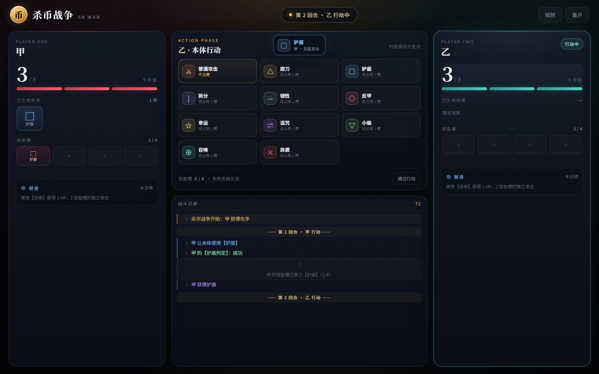
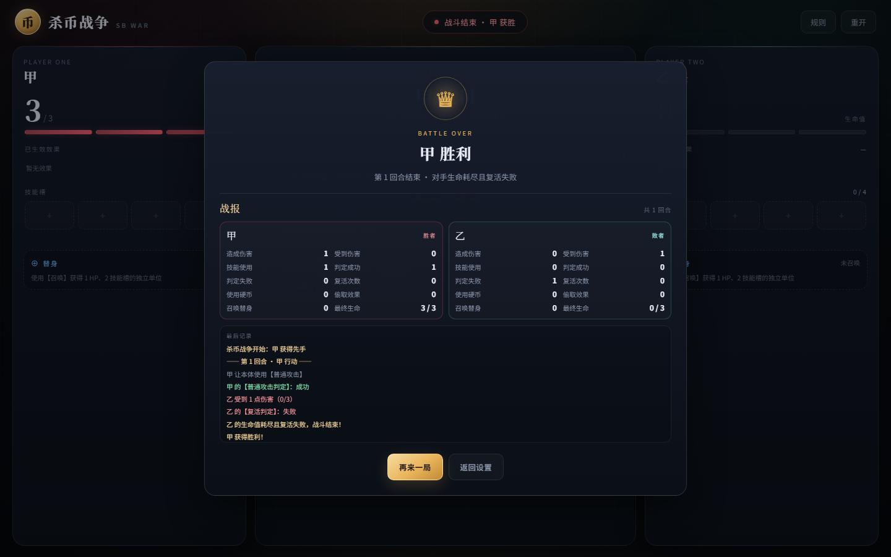
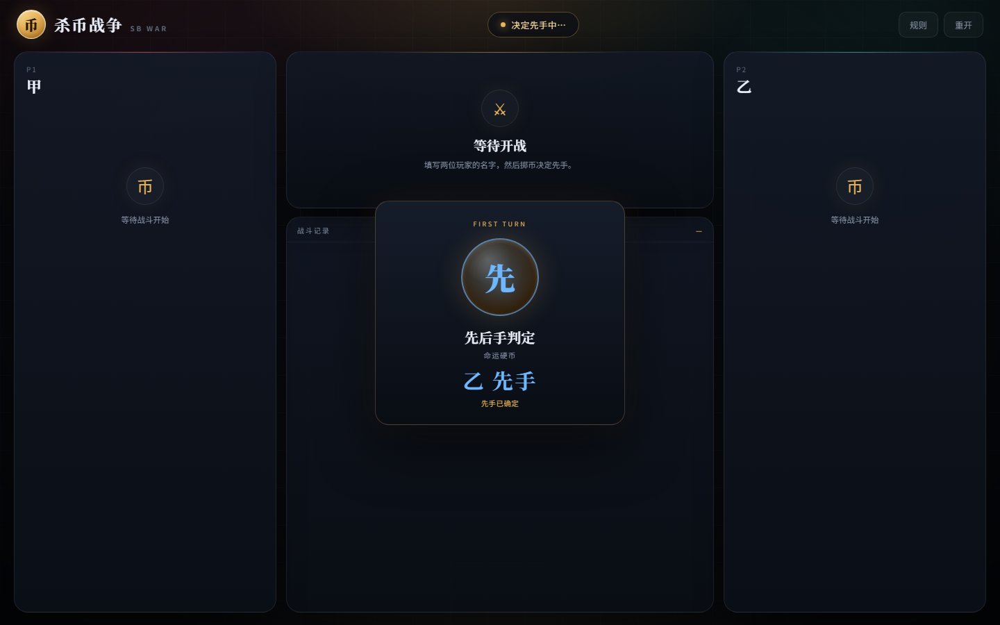
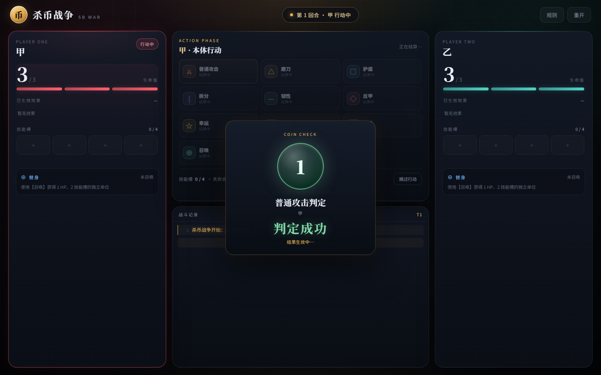
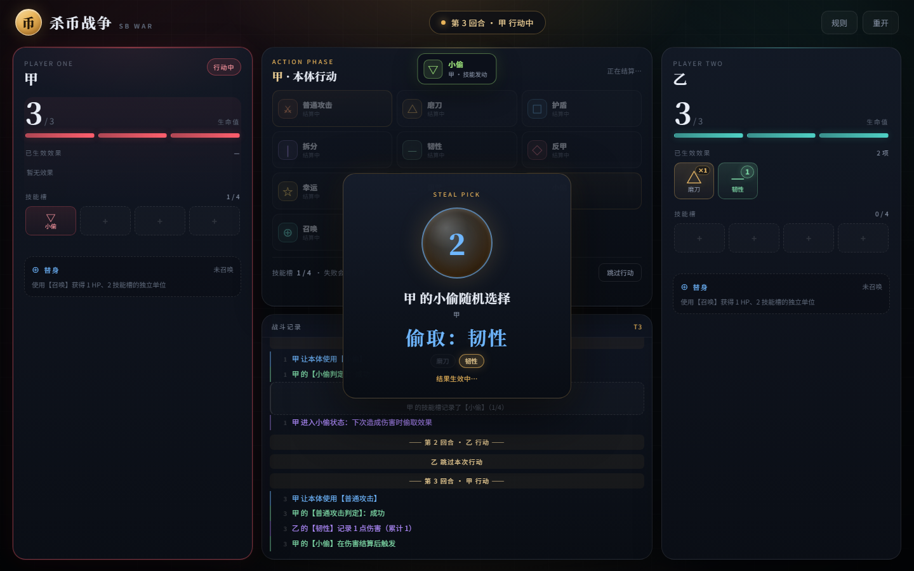
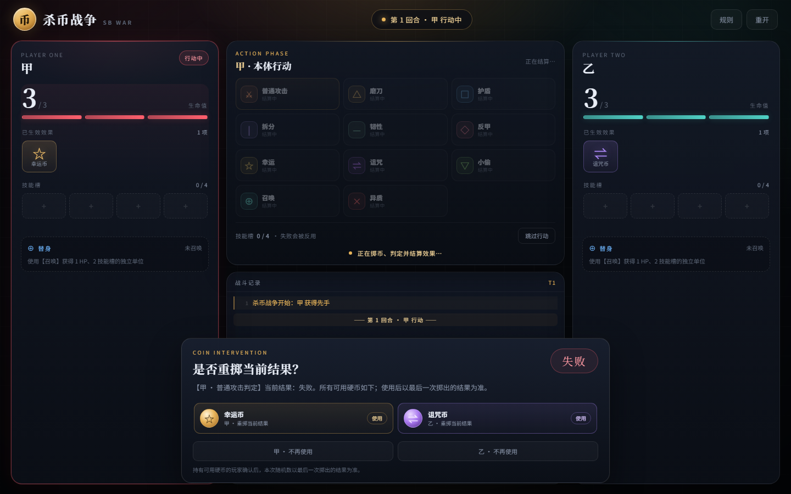
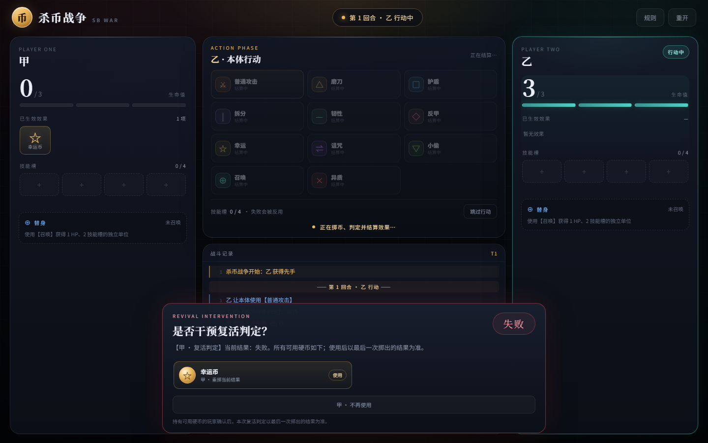

# 杀币战争 · SB WAR

基于工作区中的 [`杀币战争.txt`](杀币战争.txt) 实现的本地网页游戏，支持双人同屏或单人挑战简单 AI。每次行动都要先掷一次 0/1 判定：成功才能出招，失败则可能被对手反用。游戏包含 4 个技能槽、11 种技能、幸运/诅咒币、替身、拆分、韧性、反甲、异质、负生命惩罚与复活判定。



在开局勾选「电脑对手」，玩家二就会由启发式 AI 控制：



AI 会自动选择本体/替身、技能、目标和硬币使用时机：



技能生效时会有图标弹跳与顶部提示：



对局结束会自动显示战报：



每局开始时先播放先手判定动画：



每次判定都会先播放掷币动画，再揭晓结果并停留片刻：



小偷随机选取效果时也会播放同样的动画，并展示候选效果：



硬币干预会一次性展示所有可用硬币；只有持有可用硬币的玩家需要确认，硬币用尽后面板自动关闭。面板停靠底部，不模糊背景：



幸运币和诅咒币同样可以干预复活判定，包括负生命惩罚判定：



## 运行

**方式一：直接打开**

双击 `index.html` 即可游玩。游戏不依赖网络、构建工具或第三方库。

**方式二：本地服务器**

```bash
pnpm start
# 打开 http://127.0.0.1:4173
```

不需要先执行 `pnpm install`，项目没有运行时依赖。

## 操作

1. 输入两位玩家的名字；双人同屏直接开始，单人游玩则勾选「电脑对手」。先手由随机数决定。
2. 当前玩家在「本体 / 替身」中选择行动者（没有替身时只有本体），点击一个技能。
3. 屏幕中央播放掷币/随机数动画，结果揭晓后停留至少 1 秒；若场上有可用硬币，会打开底部硬币面板，由持有可用硬币的玩家决定是否使用或确认结束。
4. 判定成功后技能按规则生效；普通攻击判定失败会反噬自身 1 点，其他技能判定失败且对方技能槽能容纳时，对方会代为使用该技能。
5. 技能需要指定目标时（普通攻击），会弹出目标选择；幸运币/诅咒币可用时会弹出重掷确认，复活判定同样可以干预。
6. 点击「跳过行动」可以直接结束本回合。
7. 右上角「规则」随时查看完整规则和本实现的约定。

## 已实现内容

- 简单启发式 AI：自动选择行动者、技能、普通攻击目标和硬币使用时机；本体危险时会让替身行动，濒死时优先防御，对方 1 血时尝试补刀。
- 3 点初始生命、随机先手、轮流行动、跳过行动；先手判定也带掷币动画。
- 技能判定、失败反用、4 格技能槽（替身 2 格）、槽满限制。
- 普通攻击判定失败时反噬自身 1 点；自伤会触发磨刀、护盾、韧性、反甲等效果，反甲会打向对方本体。替身普攻也不再无风险。
- 11 种技能：普通攻击、磨刀、护盾、拆分、韧性、反甲、幸运、诅咒、小偷、召唤、异质。
- 硬币干预：每次生成随机数后一次性展示所有可用的幸运币/诅咒币；只有持有可用硬币的玩家需要确认，硬币用尽后面板自动关闭，以最后一次掷出的结果为准。复活判定与负生命惩罚判定同样适用。
- 随机数动画：掷币旋转、结果揭晓与停留；结果展示至少 1 秒，默认总时长约 2.4–2.8 秒，系统开启“减少动态效果”时会自动缩短。
- 偷取随机选择使用同样的动画，并列出候选效果、高亮实际偷到的效果。
- 效果连锁之间加入停顿，伤害、反甲、复活、偷取等结果会逐条展示，不会瞬间刷完。
- 已生效效果以放大的图标卡片展示，并置于技能槽上方，便于随时读取；韧性图标上直接显示当前记录伤害。
- 技能生效时，新效果图标会弹跳高亮，并在顶部显示技能名提示，便于看清本回合生效了什么。
- 战斗记录每次更新都会自动滚动到最下方。
- 对局结束后自动显示战报：双方造成/受到伤害、技能使用、判定成功/失败、复活、硬币、偷取、召唤与最终生命，并附最近战斗记录。
- 弹窗与掷币动画不再模糊背景；硬币/目标选择改为停靠底部的面板，战斗中仍可观察双方生命与效果。
- 替身：独立生命/技能槽/效果，可行动、被选为目标、独立复活；本体与替身各自选择行动者。
- 拆分阶段、韧性记录与回合结束结算、反甲连锁、异质真实伤害。
- 小偷：在伤害结算后随机偷取目标剩余效果，按技能槽条件转移，继承记录型状态。
- 复活判定、负生命惩罚判定、复活后清空效果与技能槽。

## 规则实现中的取舍

原文有几处可以作多种解释，本实现采用以下约定（游戏内「规则 → 本实现的约定」也有说明）：

| 议题 | 本实现的处理 |
| --- | --- |
| 先后手 | 每局由随机数决定；只有测试/演示接口可以显式指定先手。 |
| 每回合行动数 | 每回合使用一个技能或跳过；复活判定是额外的内联流程，不消耗回合。 |
| 判定失败承接者 | 本体失败 → 对方本体；替身失败 → 对方替身；对方没有替身时落空。普通攻击例外：反噬自身 1 点，不由对方承接。 |
| 普通攻击与技能槽 | 普通攻击不占槽；判定失败时对自身造成 1 点伤害，替身普攻同样会反噬。自伤仍会触发磨刀、护盾、韧性、反甲等效果。 |
| 自伤触发 | 自伤会触发磨刀、护盾、韧性、反甲；反甲打向对方本体。小偷需要对他者造成伤害，因此不会因自伤从自己身上偷取。 |
| 反甲与自伤 | 反甲的“对对方造成伤害”按反甲拥有者的对手理解：被对方攻击时反击来源；自伤触发时打向对方本体，可作为失败普攻的反伤操作。 |
| 韧性结算时点 | 在**拥有者自己的回合结束时**结算；再次获得韧性时立即结算全部记录伤害。 |
| 拆分阶段 | 每阶段被击破时做一次复活判定；成功保住当前阶段并保留效果；失败只失去当前阶段并进入下一阶段。**非最后阶段的负生命惩罚判定失败也只失去当前阶段，不会出局**；最后阶段失败才游戏结束。最后阶段复活后解除拆分，生命值变为 **1/3**。再次使用拆分按原文解除，生命值变为剩余阶段数。 |
| 护盾与受击效果 | 护盾挡下伤害时仍触发反甲；小偷改为在伤害结算后触发，因此护盾/反甲先结算。 |
| 真实伤害 | 无视护盾、反甲、韧性和小偷，也**不会被磨刀增幅、不会消耗磨刀层数**，但仍正常触发复活判定。 |
| 小偷触发时点 | 在伤害结算后触发：先结算伤害、护盾、反甲、复活，再从目标剩余效果中偷取。 |
| 替身上限 | 每位玩家同时只能拥有一个替身；本体死亡即游戏失败。 |
| 硬币干预 | 每次随机数生成后一次性展示所有可用的幸运币/诅咒币；只有持有可用硬币的玩家需要确认，硬币用尽后面板自动关闭，以最后一次掷出的结果为准；复活判定与负生命惩罚判定同样适用。 |
| 伤害连锁 | 反甲等连锁最多递归 16 层，避免异常状态造成无限循环。 |

## 项目结构

```
index.html              页面结构、规则手册、各类弹层
styles.css              深色桌面风格、响应式布局与动画
js/engine.js            纯逻辑规则引擎（UMD，可在浏览器/Node 中运行）
js/ai.js                简单启发式 AI（选人、选技能、选目标、硬币策略）
js/ui.js                界面渲染、事件、硬币与目标弹层、AI 回合调度
tests/engine.test.cjs   核心规则测试（23 项）
tests/engine.edge.test.cjs  边界规则测试（21 项）
tests/ai.test.cjs       AI 策略测试（7 项）
tests/all.test.cjs      在单进程中运行全部测试
scripts/serve.cjs       零依赖静态服务器
scripts/ui-smoke.cjs    可选的无头 Chrome 界面冒烟测试
docs/preview.png        界面截图
docs/setup-ai.png       电脑对手开关截图
docs/ai-turn.png        AI 回合截图
docs/effect-toast.png   技能效果提示截图
docs/report.png         战报截图
docs/first-turn.png     先手判定动画截图
docs/roll.png           随机判定动画截图
docs/steal-roll.png     偷取随机动画截图
docs/all-coins.png      硬币干预面板截图
docs/revive-coin.png    复活判定硬币干预截图
docs/target.png         目标选择面板截图
杀币战争.txt            原始规则描述
HANDOFF.md             面向后续接手 AI/开发者的交接文档
```

## 交接文档

后续接手界面、联机、美术或 AI 扩展的开发者，请先阅读 [`HANDOFF.md`](HANDOFF.md)。其中包含引擎 API、`io` 钩子契约、AI 调度、规则取舍、常见坑和扩展建议。

## 测试

规则测试不依赖浏览器：

```bash
pnpm test
# 或
node tests/all.test.cjs
```

当前共 **51 项**测试，覆盖判定成功/失败、普通攻击反噬与自伤触发磨刀/反甲、反用与技能槽、磨刀叠加、护盾+反甲、反甲连锁、韧性记录/重获/四舍五入、复活与负生命惩罚、拆分阶段/负生命惩罚失败不直接出局/最后阶段 1/3、小偷伤害后触发/槽满/随机选择、替身独立行动与复活、异质真实伤害不消耗磨刀、硬币一次性展示/最后结果/复活判定干预、随机先手、战斗统计，以及 AI 的选人/选技能/选目标/硬币策略。

可选的界面冒烟测试需要本机安装 Chrome 或 Edge：

```bash
pnpm test:ui
```

脚本会通过 DevTools Protocol 打开页面，检查掷币动画、偷取候选动画、一次性硬币面板、持有者确认/用尽自动关闭、先手判定动画、技能效果提示、战报、AI 自动行动、已生效效果尺寸/韧性记录、普通攻击、规则、幸运币重掷、替身目标选择、复活判定硬币干预与移动端横向溢出，并把截图写入 `.ui-screens/`。

## 已知限制

- 支持同一设备双人同屏或单人挑战电脑，暂未加入联机、存档或回放。
- AI 是简单启发式，不会进行深度搜索，也不会根据长局资源做复杂规划；在运气成分很大的规则下，它的行为以“合理但不一定最优”为目标。
- 规则中的歧义按上表实现；若你希望采用另一种解释，可在 `js/engine.js` 中集中调整。
- 没有音效；技能演出、伤害数字与更细的战斗动画留待后续迭代。
- 当前掷币动画默认约 2.4–2.8 秒，效果连锁还会额外停顿；连续触发多次惩罚判定时节奏会偏慢，可等待后续加入速度选项。

## 后续可以做什么

- 为每个技能补一套释放动画与音效。
- 扩展 AI 难度与策略，例如根据技能槽规划多回合行动。
- 加入回放/导出战报，便于复盘判定链。
- 把规则引擎接入联机服务器（引擎本身已与 DOM 解耦）。
