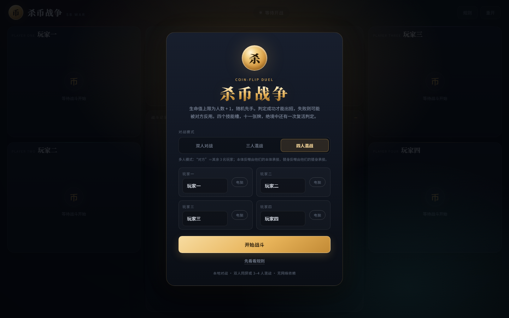
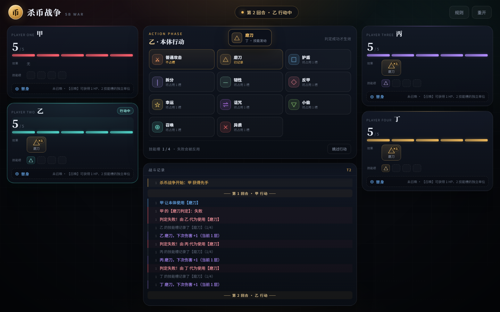
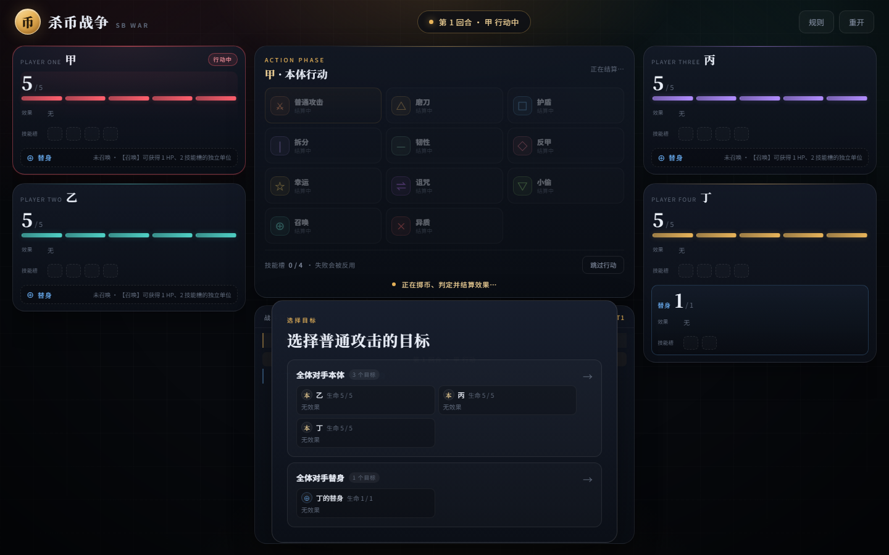
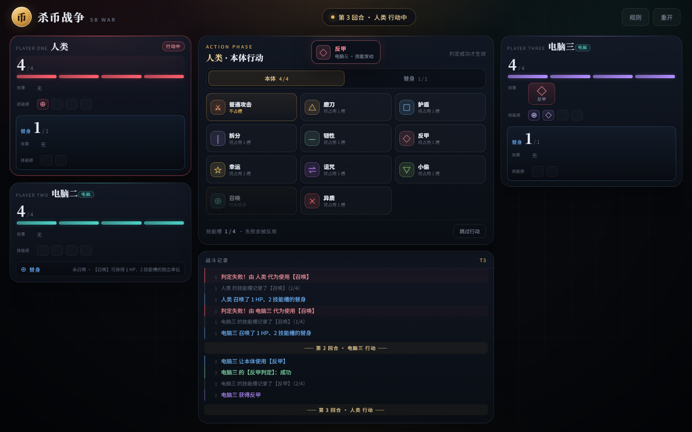
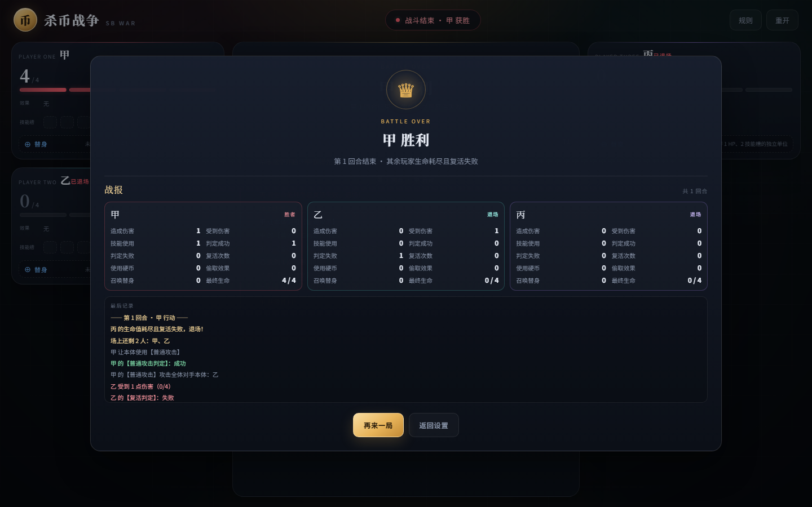
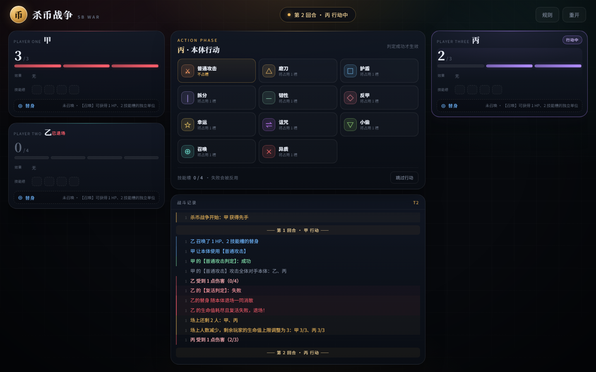
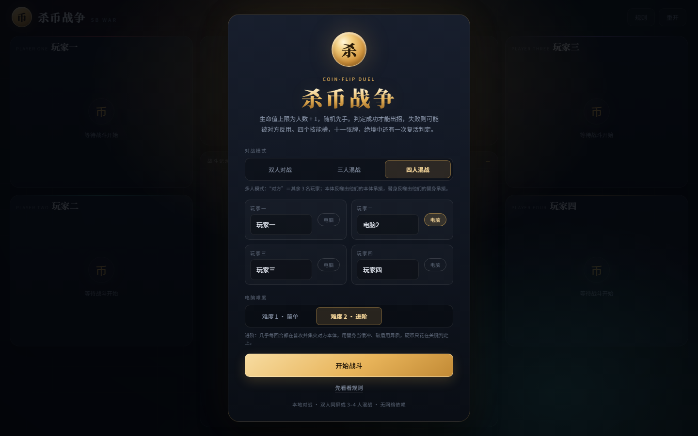
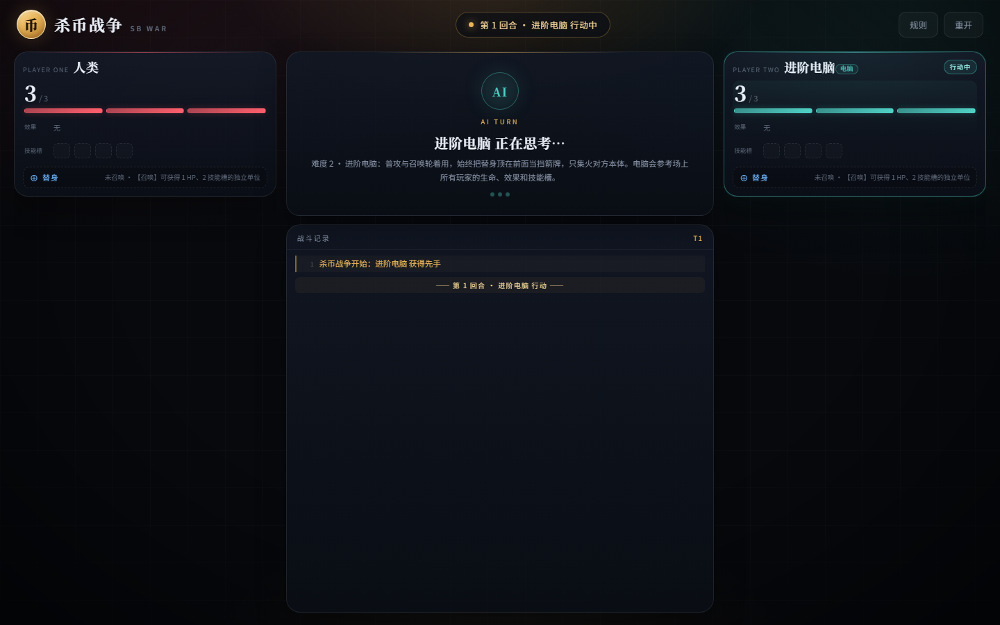
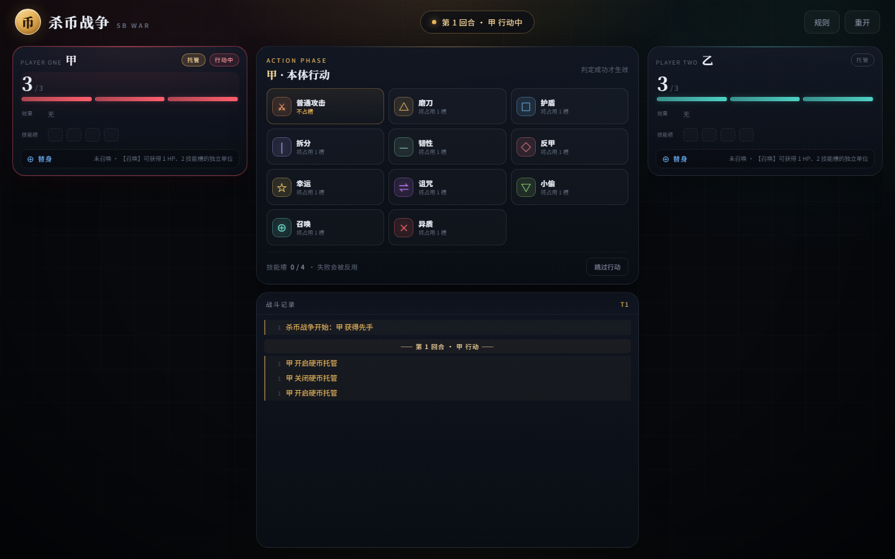
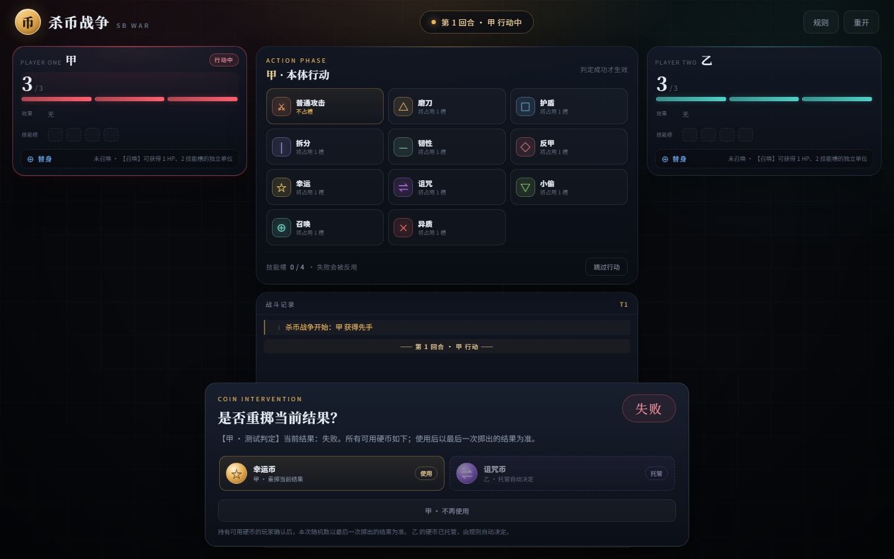

# 杀币战争 · SB WAR

基于工作区中的 [`杀币战争.txt`](杀币战争.txt) 实现的本地网页游戏，支持双人同屏、单人挑战简单 AI，以及 3–4 人混战。**生命值上限为在场人数 + 1**（2 人 3 点、4 人 5 点，有人退场时其余玩家的上限跟着下调）。每次行动都要先掷一次 0/1 判定：成功才能出招，失败则可能被对方反用。游戏包含 4 个技能槽、11 种技能、幸运/诅咒币、替身、拆分、韧性、反甲、异质、负生命惩罚与复活判定；硬币还可以交给**托管**，由规则自动决定用不用。AI 分「简单」与「进阶」两档，进阶档在双人局实测胜率约 60%、三人局约 49%、四人局约 37%（和局计入「无人获胜」）。


开局可以选择双人对战或 3–4 人混战，并给任意席位勾选「电脑」交给 AI：



多人模式中，**「对方」＝除自己以外的所有玩家**。例如本体判定失败时，其他所有玩家的本体都会代为使用该技能：



普通攻击一次覆盖一整组目标——在「全体对手本体」与「全体对手替身」之间二选一：



电脑席位在多人局里同样会逐个行动：



多人局的战报会为每位玩家各出一列，并自动加宽弹窗，避免统计项错误换行；顶部还会给出**最终排名**与**存活回合**：



一次群体攻击里，如果前面的目标复活失败退场，他的替身会一并消散，后面的目标照常结算：



在开局勾选「电脑」，玩家二就会由启发式 AI 控制：


勾选电脑后可以选择难度，「进阶」档会把替身顶在前面当挡箭牌、只打对方本体，并在回合面板说明这一手的判断：





AI 会自动选择本体/替身、技能、目标和硬币使用时机：


技能生效时会有图标弹跳与顶部提示：


对局结束会自动显示战报：


每局开始时先播放先手判定动画：


每次判定都会先播放掷币动画，再揭晓结果并停留片刻：


小偷随机选取效果时也会播放同样的动画，并展示候选效果：


硬币干预会一次性展示所有可用硬币；只有持有可用硬币的玩家需要确认，硬币用尽后面板自动关闭。面板停靠底部，不模糊背景：


幸运币和诅咒币同样可以干预复活判定，包括负生命惩罚判定：


不想每次都点确认，可以在对局里点玩家面板头部的「托管」按钮，硬币改由规则自动决定（**可选、默认关闭**）：



托管玩家的硬币会照常出现在干预面板里，但标成不可点的「托管」，不占用其他玩家的确认流程：



## 运行

**方式一：直接打开**

双击 `index.html` 即可游玩。游戏不依赖网络、构建工具或第三方库。

**方式二：本地服务器**

```bash
pnpm start
# 打开 http://127.0.0.1:4173
```

不需要先执行 `pnpm install`，项目没有运行时依赖。

## 操作

1. 选择对战模式（双人对战 / 三人混战 / 四人混战），填写玩家名字，给需要的席位勾选「电脑」。先手由随机数决定。
2. 当前玩家在「本体 / 替身」中选择行动者（没有替身时只有本体），点击一个技能。
3. 屏幕中央播放掷币/随机数动画，结果揭晓后停留至少 1 秒；若场上有可用硬币，会打开底部硬币面板，由持有可用硬币的玩家决定是否使用或确认结束。
4. 判定成功后技能按规则生效；普通攻击判定失败会反噬自身 1 点，其他技能判定失败且对方技能槽能容纳时，对方会代为使用该技能（多人模式下由其余玩家的对应实体分别承接）。
5. 技能需要选择目标时（普通攻击），会弹出攻击组选择（全体对手本体 / 全体对手替身）；幸运币/诅咒币可用时会弹出重掷确认，复活判定同样可以干预。
6. 点击「跳过行动」可以直接结束本回合。
7. 右上角「规则」随时查看完整规则和本实现的约定。
8. 每个玩家面板头部的「托管」按钮可以随时开关该席位的硬币托管（默认关闭），开关动作会记入战斗记录。

## 已实现内容

- 双人对战（2 人）与多人混战（3–4 人）；多人模式中「对方」＝全体其他玩家。
- 多人反噬：本体判定失败 → 其他所有玩家的本体代为使用；替身判定失败 → 其他所有玩家的替身代为使用；技能槽容纳不下的玩家跳过。
- 普通攻击按组结算：选择「全体对手本体」或「全体对手替身」，组内每个存活实体各受 1 点伤害。
- **磨刀的加成覆盖整组**：一次群体攻击里，磨刀层数对组内每个目标都生效（攻击结束才消耗），不会出现「第一个目标把磨刀吃掉、后面的目标只吃 1 点」的情况。
- 生命值上限＝**存活人数 + 1**（2→3、3→4、4→5）；有人退场时剩余玩家的上限跟着下调（4 人局 5→4→3），避免多人局打不完。
- **替身不再复活**：替身只有 1 点生命，被打空直接消失；本体退场或本体复活时，替身一并消散——已退场的玩家不会继续留在「全体对手替身」组里被结算。
- 多人硬币：全体对手的诅咒币都会出现在干预面板，由各自玩家确认。
- 多人回合：按玩家顺序轮流行动，已退场的玩家会被跳过，只剩最后一人时战斗结束。
- **和局**：① 超过「人数 × 25 回合」上限自动和局；② 场上所有玩家都选择跳过回合时和局。和局时**还在场上的玩家并列第一**，已退场的玩家按存活回合排在后面。
- 紧凑玩家面板：每块面板按内容高度排布（实测约 378×200，本体 4 效果 + 替身 2 效果的最坏情况 378×338），四人局一屏可见；左右两列堆叠，四种配色区分席位。血条、效果、技能槽三段之间留有间距。
- 任意席位都可以交给 AI（多人局里多个电脑会依次行动）。
- **两档 AI 难度**：开局勾选电脑后可选择「简单（难度 1）」或「进阶（难度 2）」，选择会记住到本地。
  - 难度 1：按固定优先级 + 概率试探，容易浪费技能和硬币。
  - 难度 2：**以输出为主**（模拟中九成回合都在普攻或召唤）、**只打对方本体组**（本体才是胜负条件）、**把替身当挡箭牌**（替身顶在前面替本体扛自伤，本体 3 血以下就让替身出手，替身被打空也只损失替身）、**本体 1 血时不浪费回合**、**破盾用异质**、**硬币只花在关键判定上**（复活判定必救、对手复活/技能成功就压掉）。难度 2 会在 AI 回合面板显示这一手的判断理由。
  - 实测胜率（难度 2 对难度 1，脚本 `scripts/ai-arena.cjs`）：双人局 **约 60%**（同质基线 50%）、三人局 **约 49%**（基线 33%）、四人局 **约 37%**（基线 25%）。**和局计入「无人获胜」**：加入和局规则后，难度 2 的长局更容易被判和局，胜率因此从 78%/57%/44% 降下来；参数扫描显示这部分损失与策略无关，所以没有改 AI 权重。
  - 另有 `scripts/ai-arena-vs-body.cjs`：把难度 1 改成「永远攻击对方本体」（更聪明的对手）再打一遍，难度 2 仍能拿到约 69%，说明不是只在对笨对手过拟合。
- 3 点初始生命、随机先手、轮流行动、跳过行动；先手判定也带掷币动画。
- 技能判定、失败反用、4 格技能槽（替身 2 格）、槽满限制。
- 普通攻击判定失败时反噬自身 1 点；自伤会触发磨刀、护盾、韧性、反甲等效果，反甲会打向对方本体。替身普攻也不再无风险。
- 11 种技能：普通攻击、磨刀、护盾、拆分、韧性、反甲、幸运、诅咒、小偷、召唤、异质。
- 硬币干预：每次生成随机数后一次性展示所有可用的幸运币/诅咒币；只有持有可用硬币的玩家需要确认，硬币用尽后面板自动关闭，以最后一次掷出的结果为准。复活判定与负生命惩罚判定同样适用。
- **硬币托管（可选，默认关闭）**：**对局内随时在玩家面板头部点「托管」开关**。托管后该玩家的硬币改由规则自动决定——自己判定失败时自动用幸运币救回、对方判定失败时自动弃权诅咒币、非判定（骰子）一律弃权；托管玩家不再弹确认面板。任何席位（含电脑）都可以托管，状态会记住到本地。
- 随机数动画：掷币旋转、结果揭晓与停留；结果展示至少 1 秒，默认总时长约 2.4–2.8 秒，系统开启“减少动态效果”时会自动缩短。
- 偷取随机选择使用同样的动画，并列出候选效果、高亮实际偷到的效果。
- 效果连锁之间加入停顿，伤害、反甲、复活、偷取等结果会逐条展示，不会瞬间刷完。
- 已生效效果以放大的图标卡片展示，并置于技能槽上方，便于随时读取；韧性图标上直接显示当前记录伤害。
- 技能生效时，新效果图标会弹跳高亮，并在顶部显示技能名提示，便于看清本回合生效了什么。
- 战斗记录每次更新都会自动滚动到最下方。
- 对局结束后自动显示战报：**最终排名**（胜者第一，其余按「在场上待得更久」排序）、**存活回合**、退场顺序，以及每位玩家单列统计（造成/受到伤害、技能使用、判定成功/失败、复活、硬币、偷取、召唤与最终生命），并附最近战斗记录。
- 弹窗与掷币动画不再模糊背景；硬币/目标选择改为停靠底部的面板，战斗中仍可观察双方生命与效果。
- 替身：独立生命/技能槽/效果，可行动、被选为目标；**不再复活**，本体退场或复活时一并消散。
- 拆分阶段、韧性记录与回合结束结算、反甲连锁、异质真实伤害。
- 小偷：在伤害结算后随机偷取目标剩余效果，按技能槽条件转移，继承记录型状态。
- 复活判定、负生命惩罚判定、复活后清空效果与技能槽。

## 规则实现中的取舍

原文有几处可以作多种解释，本实现采用以下约定（游戏内「规则 → 本实现的约定」也有说明）：

| 议题 | 本实现的处理 |
| --- | --- |
| **生命值上限** | **存活人数 + 1**（2→3、3→4、4→5）。有人退场时剩余玩家的上限跟着下调（超出的当前血量直接削到新上限），复活回满、拆分解除都按当时的上限。 |
| **替身是否复活** | **不再复活。** 替身只有 1 点生命，被打空直接消失，也不做负生命惩罚判定——它是纯粹的一次性挡箭牌。 |
| **本体与替身的关系** | 本体退场或本体复活时，**替身一并消散**。这样已退场的玩家不会继续留在「全体对手替身」组里被攻击、被判定。 |
| **普通攻击** | 不再选单个目标：改为在**全体对手本体**与**全体对手替身**之间二选一，组内每个存活实体各受 1 点伤害；判定失败仍反噬自身。 |
| **磨刀在群体攻击里** | 磨刀是「**这一次攻击**」的加成：整组目标共享同一份加成，攻击结束后统一消耗。真实伤害（异质）既不增幅也不消耗磨刀。普攻失败的自伤同样享受磨刀增幅。 |
| 先后手 | 每局由随机数决定；只有测试/演示接口可以显式指定先手。 |
| 每回合行动数 | 每回合使用一个技能或跳过；复活判定是额外的内联流程，不消耗回合。 |
| **“对方”的含义** | **双人＝唯一对手；多人（3–4 人）＝除自己以外的所有玩家。** 攻击组、诅咒币持有者、反甲自伤的去向、技能反噬的承接者都按这个定义展开。 |
| 判定失败承接者 | 本体失败 → 对方本体；替身失败 → 对方替身；没有对应实体时落空。多人模式下改为**其他所有玩家的对应实体依次承接**，各自判断技能槽是否容纳。普通攻击例外：反噬自身 1 点，不由对方承接。 |
| 普通攻击与技能槽 | 普通攻击不占槽；判定失败时对自身造成 1 点伤害，替身普攻同样会反噬。自伤仍会触发磨刀、护盾、韧性、反甲等效果。 |
| 自伤触发 | 自伤会触发磨刀、护盾、韧性、反甲；反甲打向对方本体。小偷需要对他者造成伤害，因此不会因自伤从自己身上偷取。 |
| 反甲与自伤 | 反甲的“对对方造成伤害”按反甲拥有者的对手理解：被对方攻击时反击来源；自伤触发时打向对方本体，可作为失败普攻的反伤操作。 |
| 韧性结算时点 | 在**拥有者自己的回合结束时**结算；再次获得韧性时立即结算全部记录伤害。 |
| 拆分阶段 | 每阶段被击破时做一次复活判定；成功保住当前阶段并保留效果；失败只失去当前阶段并进入下一阶段。**非最后阶段的负生命惩罚判定失败也只失去当前阶段，不会出局**；最后阶段失败才游戏结束。最后阶段复活后解除拆分，生命值只剩 **1 点**（上限为人数 + 1）。再次使用拆分按原文解除，生命值变为剩余阶段数。 |
| 护盾与受击效果 | 护盾挡下伤害时仍触发反甲；小偷改为在伤害结算后触发，因此护盾/反甲先结算。 |
| 真实伤害 | 无视护盾、反甲、韧性和小偷，也**不会被磨刀增幅、不会消耗磨刀层数**，但仍正常触发复活判定。 |
| 小偷触发时点 | 在伤害结算后触发：先结算伤害、护盾、反甲、复活，再从目标剩余效果中偷取。 |
| 替身上限 | 每位玩家同时只能拥有一个替身；本体退场（或复活）时代身一并消散，不会出现“已退场的人还挂着替身”。 |
| 硬币干预 | 每次随机数生成后一次性展示所有可用的幸运币/诅咒币；只有持有可用硬币的玩家需要确认，硬币用尽后面板自动关闭，以最后一次掷出的结果为准；复活判定与负生命惩罚判定同样适用。幸运币属于掷数者本人，诅咒币属于全体对手。 |
| **硬币托管（可选）** | **对局内随时在玩家面板头部点「托管」开关**（引擎方法 `setCoinEscrow`），默认关闭，开局设置里没有这个选项。托管后该玩家的硬币由**规则**自动决定：自己判定失败（投出 0）→ 自动用幸运币救回；自己判定成功（投出 1）→ 弃权幸运币；对方判定成功（投出 1）→ 自动用诅咒币压掉；对方判定失败（投出 0）→ 弃权诅咒币；非判定（骰子）→ 一律弃权。托管玩家不再弹确认面板。**结算顺序**是「自己的托管幸运币 → 手动面板 → 托管诅咒币收尾」，保证托管的诅咒币作用在**最终判定值**上。任何席位（含电脑）都能托管。 |
| 伤害连锁 | 反甲等连锁最多递归 16 层，避免异常状态造成无限循环。 |
| 多人收尾 | 被淘汰的玩家不再行动，回合按在场玩家顺序轮转；反甲连锁可能同时带走最后两人，此时判平局。 |
| **最终排名** | 胜者第一；其余按「在场上待得更久」排序（最后退场的排前面）。全员阵亡判平局时不排名。存活回合＝该玩家在场的回合数。**和局时还在场上的玩家并列第一**。 |
| **和局条件** | ① 回合计数超过「人数 × 25」→ 和局（双人局 50、三人局 75、四人局 100）；② 场上所有玩家都选择跳过回合 → 和局。有人真的出手会清空「连续跳过」计数。 |

## 项目结构

```
index.html              页面结构、规则手册、各类弹层
styles.css              深色桌面风格、响应式布局与动画
js/engine.js            纯逻辑规则引擎（UMD，可在浏览器/Node 中运行）
js/ai.js                启发式 AI：难度 1（简单）/ 难度 2（进阶），选人、选技能、选目标、硬币策略
js/ui.js                界面渲染、事件、硬币与目标弹层、AI 回合调度
tests/engine.test.cjs   核心规则测试（23 项）
tests/engine.edge.test.cjs  边界规则测试（21 项）
tests/multiplayer.test.cjs  多人模式测试（18 项）
tests/balance.test.cjs  平衡性调整的规则回归（13 项：替身不复活、退场清替身、上限动态下调、排名统计）
tests/escrow.test.cjs   硬币托管的规则测试（12 项：自动用币/弃权、面板免打扰、结算顺序）
tests/ai.test.cjs       难度 1 的 AI 策略测试（7 项）
tests/ai-hard.test.cjs  难度 2 的 AI 策略测试（24 项，含出手结构统计回归）
tests/all.test.cjs      在单进程中运行全部测试
scripts/serve.cjs       零依赖静态服务器
scripts/ui-smoke.cjs    可选的无头 Chrome 界面冒烟测试
scripts/ai-arena.cjs    AI 对局模拟：统计不同难度、不同人数下的胜率
scripts/ai-arena-vs-body.cjs  对手画像对照：难度 2 面对「打替身 / 打本体」两种难度 1 打法
scripts/ai-diagnose.cjs AI 行为诊断：技能使用、伤害、回合与胜率明细
scripts/ai-sweep.cjs    双人局参数扫描（同一批种子对比不同调参方案）
scripts/ai-sweep-battle.cjs  多人局参数扫描
scripts/ai-sweep-final.cjs   双人局 + 三人局合并对比
scripts/ai-sweep-tune.cjs    通用调参扫描（可传人数，含平均回合数）
scripts/fuzz-multiplayer.cjs 多人局不变量 fuzz（随机对局 + 状态自洽检查）
scripts/probe-group-damage.cjs 群体伤害结算探针（含“前一个目标复活失败”场景）
scripts/probe-sharpen-group.cjs 磨刀群体加成探针（含“护盾+拆分”组合场景）
scripts/probe-mechanics.cjs  规则交互探针（反甲/磨刀/硬币/反噬的实测）
scripts/probe-hp.cjs    有效生命探针（拆分 / 护盾能挨几下）
scripts/ai-trace.cjs    双人局逐步决策追踪
scripts/ai-trace-battle.cjs  多人局逐步决策追踪
docs/preview.png        界面截图
docs/setup-ai.png       电脑对手开关截图
docs/difficulty.png    难度选择截图
docs/ai-turn-hard.png  进阶电脑回合截图
docs/setup-multiplayer.png    对战模式与席位设置截图
docs/ai-turn.png        AI 回合截图
docs/effect-toast.png   技能效果提示截图
docs/report.png         战报截图
docs/first-turn.png     先手判定动画截图
docs/roll.png           随机判定动画截图
docs/steal-roll.png     偷取随机动画截图
docs/all-coins.png      硬币干预面板截图
docs/revive-coin.png    复活判定硬币干预截图
docs/target.png         目标选择面板截图
docs/multiplayer-backlash.png  多人反噬截图
docs/multiplayer-target.png    多人目标选择截图
docs/multiplayer-ai.png         多人电脑回合截图
docs/multiplayer-report.png     多人战报截图（含最终排名 / 存活回合）
docs/group-damage.png           群体攻击中前一个目标复活失败后的结算截图
杀币战争.txt            原始规则描述
HANDOFF.md             面向后续接手 AI/开发者的交接文档
```

## 交接文档

后续接手界面、联机、美术或 AI 扩展的开发者，请先阅读 [`HANDOFF.md`](HANDOFF.md)。其中包含引擎 API、`io` 钩子契约、AI 调度、规则取舍、常见坑和扩展建议。

## 测试

规则测试不依赖浏览器：

```bash
pnpm test
# 或
node tests/all.test.cjs
```

当前共 **130 项**测试，覆盖判定成功/失败、普通攻击反噬与自伤触发磨刀/反甲、反用与技能槽、磨刀叠加、护盾+反甲、反甲连锁、韧性记录/重获/四舍五入、复活与负生命惩罚、拆分阶段/负生命惩罚失败不直接出局/最后阶段复活只剩 1 点、小偷伤害后触发/槽满/随机选择、替身独立行动、异质真实伤害不消耗磨刀、硬币一次性展示/最后结果/复活判定干预、随机先手、战斗统计、多人模式（3–4 人的攻击分组、全体对手承接反噬、生命值上限＝人数 + 1、诅咒币覆盖、回合轮转与淘汰、胜负与平局、双人行为回归），**平衡性调整（替身不再复活、本体退场/复活时清替身、群体攻击中前一个目标复活失败后后续目标仍如实结算、退场后生命值上限下调、最终排名与存活回合统计、磨刀加成覆盖整组目标、和局的两种触发方式与并列第一）**，**硬币托管（自动用币/弃权、托管免打扰面板、托管诅咒币作用在最终判定值上、对局内随时开关）**，以及 AI 的选人/选技能/选目标/硬币策略与难度 2 的出手结构（普攻+召唤占比、无把握技能占比、收割、替身顶替、硬币时机）。

可选的界面冒烟测试需要本机安装 Chrome 或 Edge：

```bash
pnpm test:ui
```

脚本会通过 DevTools Protocol 打开页面，检查掷币动画、偷取候选动画、一次性硬币面板、持有者确认/用尽自动关闭、先手判定动画、技能效果提示、战报、AI 自动行动、已生效效果尺寸/韧性记录、普通攻击、规则、幸运币重掷、替身攻击组选择、复活判定硬币干预、**电脑开关可点击**、**难度选择（显隐、切换、持久化、AI 回合面板标注难度并给出判断理由）**、**玩家面板尺寸 ≤ 512×512（最坏情况）**，以及多人模式（设置页切换四人混战、四块面板分列、多人反噬落进对方面板、攻击组覆盖全体对手、多人硬币多人确认、多个电脑依次行动、多人战报、移动端四人局无横向溢出），并把截图写入 `.ui-screens/`。

### AI 强度怎么量化

难度之间不靠"感觉"，而是用对局模拟对比（同一个随机种子流，重复足够多的对局）：

```bash
node scripts/ai-arena.cjs 400 2   # 双人局：难度 2 对难度 1 的胜率
node scripts/ai-arena.cjs 200 3   # 三人局
node scripts/ai-arena-vs-body.cjs 400 2  # 对手画像对照：打替身 vs 打本体
node scripts/ai-diagnose.cjs 200 2 # 技能使用 / 伤害 / 回合明细
node scripts/ai-sweep.cjs 200 2   # 参数扫描：同一批种子对比不同方案
```

400 局时的噪声约 ±2.4%，要判断"真的更强"建议至少跑到 400 局，并同时看诊断里的**普攻次数**与**伤害/回合**——旧版难度 2 有 75% 的回合在用技能，伤害输出只有难度 1 的四成。

调参还有一条硬规矩：**不要只看单人局胜率**。难度 2 的挡箭牌策略在“对笨对手”时特别吃香，所以要额外用 `ai-arena-vs-body.cjs` 换成“永远打本体”的对手再验一遍，确认不是过拟合。

## 已知限制

- 支持 2 人对决或 3–4 人混战，均为同设备本地轮流操作，暂未加入联机、存档或回放。
- 人数上限 4 人（`MAX_PLAYERS`）；再往上会让同屏面板过于拥挤。
- AI 是启发式的，不会进行深度搜索；在运气成分很大的规则下，它的行为以“合理但不一定最优”为目标。难度 2 在双人局明显强于难度 1（胜率约 60% vs 50%），三人局 49%（基线 33%），四人局 37%（基线 25%）。**和局计入「无人获胜」**，加上和局规则后胜率比早先更低（78% / 57% / 44%），这是长局被判和局造成的，不是策略退化。
- 难度 2 的“挡箭牌”打法会让对局变长（双人局平均约 31 回合、三人局约 46、四人局约 62）：替身被反复打掉再召唤是这套打法的一部分。嫌慢可以把 `js/ai.js` 的 `HARD_TUNE.summonBase` 调低（145 → 130 会让胜率回落到 67% 左右）。
- 规则中的歧义按上表实现；若你希望采用另一种解释，可在 `js/engine.js` 中集中调整。
- 没有音效；技能演出、伤害数字与更细的战斗动画留待后续迭代。
- 当前掷币动画默认约 2.4–2.8 秒，效果连锁还会额外停顿；连续触发多次惩罚判定时节奏会偏慢，可等待后续加入速度选项。

## 后续可以做什么

- 为每个技能补一套释放动画与音效。
- 再加一档"专家"难度：按技能槽规划多回合行动（例如提前囤幸运币、算准对手磨刀层数）。
- 加入回放/导出战报，便于复盘判定链。
- 把规则引擎接入联机服务器（引擎本身已与 DOM 解耦）。
- 多人模式目前固定 2–4 人，可考虑更大的人数上限或分组对抗。
